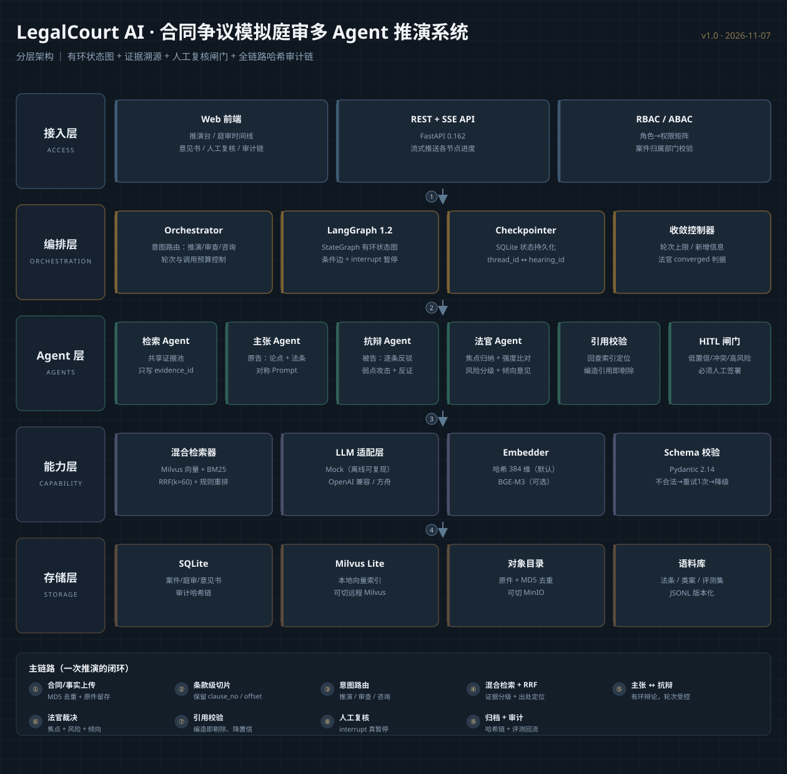

# LegalCourt AI · 合同争议模拟庭审多 Agent 推演系统

把「争议事实 + 合同条款」变成一场**可审计的模拟庭审**：原告 Agent 举证、被告 Agent 逐条质证、法官 Agent 归纳焦点并裁决，命中风险或证据冲突时自动暂停，等法务人工签署后才归档。

与普通 RAG 的区别只有一句话：**不是一次检索生成结论，而是两个目标对立的 Agent 互相攻击，再由仲裁层按证据效力层级收敛。**

---

## 1. 它能做什么

| 能力 | 说明 |
|---|---|
| 争议推演 | 识别争议焦点 → 双方各自检索法条/类案 → 多轮主张与抗辩 → 法官裁决（风险等级、倾向性意见、补强建议） |
| 证据溯源 | 每条论点都必须挂 `evidence_id`；点开可回到"民法典第 585 条""合同第 7 条""（2021）京 03 民终 1234 号" |
| 冲突处置 | 同层级类案结论相反时标记冲突；有更高层级依据则按效力层级取舍，否则转人工 |
| 引用校验 | 落库前逐条校验引用是否真实存在，无效引用直接剔除并下调置信度 |
| 人工复核（HITL） | 图内 `interrupt` 暂停，`Command(resume=...)` 续跑；驳回必须填理由，最多回炉 2 次 |
| 审计留痕 | 全链路哈希链，任何一条被改/被删都会在 `verify` 时暴露 |
| 权限边界 | RBAC（律师/复核/审计/管理员）+ ABAC（本人/本部门；审计与管理员跨部门只读） |

**明确不做**：不做法律意见的最终定论、不做 PDF 解析、不做多租户计费。系统输出的是"可复核的推演材料"，署名权与责任仍在执业律师。

---

## 2. 快速开始

```bash
cd LegalCourtAI
python3 -m venv .venv && . .venv/bin/activate
pip install -r requirements.txt
export PYTHONPATH=src

# 启动（http://127.0.0.1:8000）
python -m uvicorn legalcourt.api.main:app --host 127.0.0.1 --port 8000

# 另开一个终端：跑通全链路（建案 → SSE 推演 → HITL → 意见书 → 审计校验）
python scripts/smoke_api.py          # 正常案例
python scripts/smoke_api.py --weak   # 证据不足案例（会停在 HITL）
```

打开浏览器访问 `http://127.0.0.1:8000/`，左侧选示例 → 点「开始模拟庭审」，即可看到逐节点时间线；命中复核时右侧弹出签署面板。

其他命令：

```bash
make test     # pytest：切片 / RRF / 审计链 / 收敛 / HITL / 接口鉴权
make eval     # 8 条标注用例，输出 14 项指标 + docs/04-测试与评测报告.md
make svg      # 重新生成 docs/assets/architecture.svg
```

---

## 3. 架构



五层：接入（FastAPI/SSE/静态前端）→ 编排（LangGraph 有环状态图 + Checkpointer）→ Agent（检索/主张/抗辩/法官/引用校验）→ 能力（混合检索、Mock/OpenAI 兼容 LLM、RBAC/ABAC、审计）→ 存储（SQLite、milvus-lite、本地对象目录、进程内 LRU）。

图的主链路：

```
ingest → orchestrate → retrieve → plaintiff ⇄ defendant → judge
                                      ↑                    │
                                      └── reject & revision ┘
judge → cite_guard → hitl_gate → finalize
```

关键点：
- `judge` 有两条出边：未收敛回 `plaintiff`（成环），收敛走 `cite_guard`；
- `hitl_gate` 用 `interrupt()` 真暂停，状态由 `SqliteSaver` 持久化，进程重启后可继续；
- `recursion_limit=40` 兜底，`MAX_ROUNDS=3`、`MAX_REVISIONS=2` 双重限流。

---

## 4. 目录

```
LegalCourtAI/
├── src/legalcourt/
│   ├── config.py            # 全部开关集中在此（.env 覆盖）
│   ├── schemas.py           # 证据/论点/焦点/冲突/意见书 JSON Schema
│   ├── db.py                # SQLite(WAL)：案件、庭审、审计、文档
│   ├── audit.py             # SHA256 哈希链
│   ├── security.py          # RBAC + ABAC
│   ├── service.py           # 建案/流式运行/中断恢复/详情
│   ├── llm/                 # base / mock / openai_compat / prompts / topics
│   ├── rag/                 # ingest（切片）/ store（向量+BM25）/ hybrid（RRF+重排）
│   ├── graph/               # state / nodes / build
│   ├── api/main.py          # 18 条路由（含 SSE 与静态挂载）
│   └── eval/                # metrics / run_eval
├── data/
│   ├── corpus/              # 42 法条 + 5 司法解释 + 16 类案（带 favor 立场）
│   ├── samples/             # 3 组「合同 + 事实」示例
│   ├── eval/                # 8 条标注用例 + results.json
│   └── runtime/             # SQLite / checkpoint / 原件（git 忽略）
├── web/                     # 零构建前端（index.html + app.js + style.css）
├── tests/                   # 26 个 pytest 用例
├── docs/                    # 01 需求痛点 / 02 流程重构 / 03 架构 / 04 评测 / 05 面试
└── scripts/                 # smoke_api / seed_corpus / run_server / run_eval / 架构图
```

---

## 5. 接口（前缀 `/api/v1`）

| 方法 | 路径 | 说明 |
|---|---|---|
| GET | `/healthz` | 模型、索引规模、向量后端、阈值 |
| POST | `/api/v1/cases` | 建案（JSON） |
| POST | `/api/v1/cases/upload` | 建案（multipart；PDF 暂不支持） |
| POST | `/api/v1/hearings/stream` | **SSE**：`init/timeline/interrupt/awaiting/done/error` |
| POST | `/api/v1/hearings/{id}/hitl` | 复核（幂等；状态非 awaiting 返回 409） |
| GET | `/api/v1/hearings/{id}` | 庭审详情 + 意见书 |
| GET | `/api/v1/audit`、`/audit/verify` | 审计列表 / 哈希链校验 |
| GET | `/api/v1/corpus/search` | 语料检索（带 locator） |

鉴权：演示态读请求头 `X-User / X-Role / X-Dept`（中文部门名需 percent-encoding）；生产替换 `get_principal` 为 JWT 即可。

---

## 6. 从单机切生产

本环境无 Docker / ES / MySQL / Redis，因此全部用**能力等价、接口可切**的形态实现，切换只改 `.env`：

| 单机实现 | 生产替换 | 开关 |
|---|---|---|
| milvus-lite | Milvus / Zilliz | `MILVUS_URI` |
| rank-bm25 | Elasticsearch BM25 | `BM25_BACKEND=es`（预留） |
| SQLite(WAL) | MySQL / PostgreSQL | `DB_URL`（预留） |
| 本地对象目录 | MinIO / S3 | `STORAGE_BACKEND=s3`（预留） |
| 进程内 LRU | Redis | `CACHE_BACKEND=redis`（预留） |
| Mock LLM | 火山方舟 / DeepSeek / vLLM | `LLM_PROVIDER=openai` + `LLM_BASE_URL/API_KEY/MODEL` |

`docker-compose.yml` 是**生产可选模板**（当前环境无 Docker，未实测），不要把它当运行前提。

---

## 7. 已知短板

1. **法条召回 0.60**：扩语料 + 语义向量，别靠调 top_k。
2. **焦点精确率 0.45**：每案固定输出至多 5 个焦点，弱相关焦点会稀释精确率；应改为"证据支撑度阈值 + 动态数量"。
3. **Mock 论证质量有限**：模板化文本，价值在于把工程机制压成可回归基线。
4. **PDF 未解析**：上传即 400，提示粘贴文本或传 `.md/.txt`。
5. **风险/倾向一致率 0.63 / 0.50**：启发式权重需与法务共同校准，标注本身也有主观性。

---

## License

仅用于学习与作品展示；语料为公开法条与脱敏改编案例，不构成法律意见。
