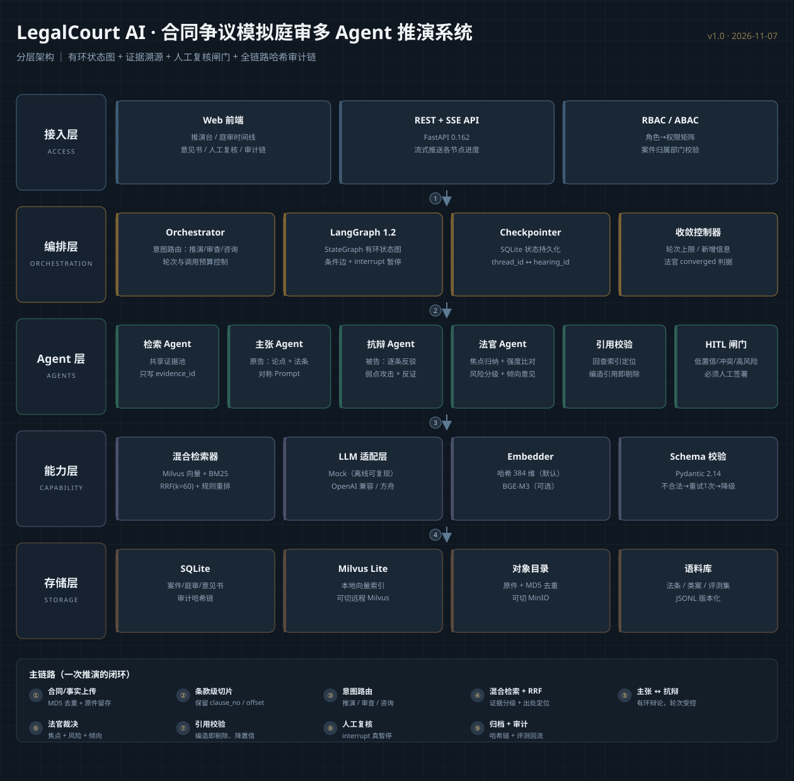
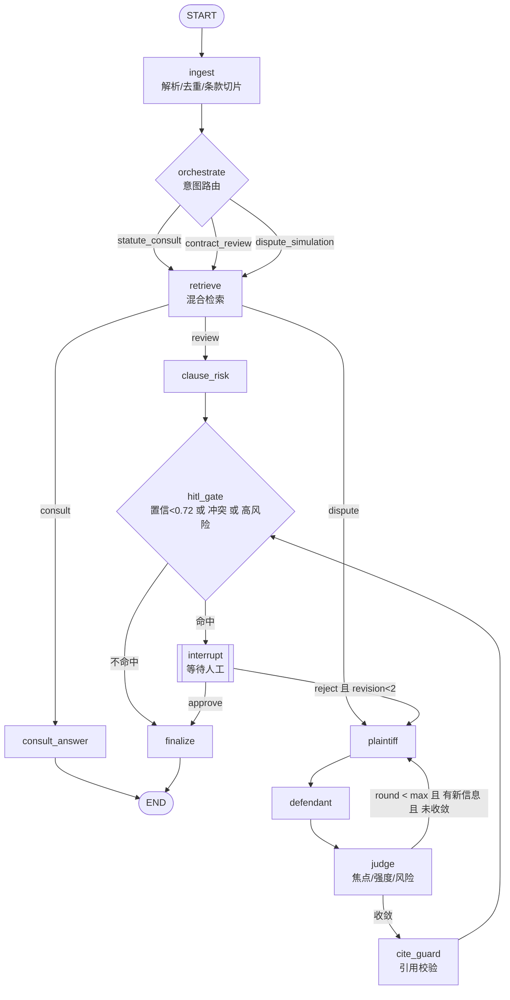

# 八、技术栈与项目架构（第 8 步）



## 8.1 分层架构

```
┌──────────── 接入层 ────────────┐   Web 前端（原生 JS，无构建）· REST + SSE · RBAC/ABAC 网关
├──────────── 编排层 ────────────┤   Orchestrator 路由 · LangGraph StateGraph · Checkpointer · 预算/收敛控制
├──────────── Agent 层 ──────────┤   检索 · 主张 · 抗辩 · 法官 · 引用校验 · HITL 闸门
├──────────── 能力层 ────────────┤   混合检索（向量+BM25+RRF+重排）· LLM 适配 · Embedder · Schema 校验
└──────────── 存储层 ────────────┘   SQLite（元数据+审计链）· Milvus · 对象目录 · 语料库 JSONL
```

**Mermaid 版（有环状态图，与代码 `graph/build.py` 一致）**



## 8.2 技术栈与锁定版本

> 版本以当前环境 `pip freeze` 实测为准（Python 3.12.11 / Linux x86_64）。
> **重要**：本环境没有 Docker，也没有 MinIO/ES/MySQL/Redis 服务，因此默认走"**能力等价、接口可切**"的单机形态；每个被替代的组件都保留了生产切换开关（`.env` 一行配置）。

| 层 | 技术 | 锁定版本 | 职责 | 为什么选它 | 生产切换 |
|---|---|---|---|---|---|
| Web 框架 | fastapi | `0.162.0` | REST + SSE | 原生支持流式响应、Pydantic 集成 | — |
| ASGI | uvicorn[standard] | `0.54.0` | 服务运行 | 稳定 + uvloop 可选 | gunicorn+uvicorn worker |
| 数据契约 | pydantic | `2.14.3` | 意见书 JSON Schema 校验 | 强校验、错误定位精确 | — |
| 配置 | pydantic-settings | `2.16.2` | `.env` 类型化配置 | 环境隔离 | — |
| 编排 | langgraph | `1.2.20` | 有环状态图 + 条件边 + `interrupt` | 唯一成熟支持"图内暂停/恢复"的框架 | 不变 |
| 状态持久化 | langgraph-checkpoint-sqlite | `3.1.3` | 断点续跑 | 零依赖、单文件 | `langgraph-checkpoint-postgres` |
| 向量库 | pymilvus | `3.0.2` | 向量检索客户端 | 与生产 Milvus 同 API | `MILVUS_URI=http://milvus:19530` |
| 本地向量后端 | milvus-lite | `3.2.2` | 无 Docker 跑 Milvus | 同协议、免运维 | 生产用集群 |
| 关键词检索 | rank-bm25 | `0.2.2` | BM25 召回 | 纯 Python，无需 ES | `ES_BM25` 适配器（预留） |
| 中文分词 | jieba | `0.42.1` | 检索/词面重合特征 | 法律术语可加自定义词典 | — |
| 数值 | numpy | `2.5.4` | 向量归一化/相似度 | — | — |
| HTTP 客户端 | httpx | `0.28.1` | 真实 LLM 调用 | 支持超时/重试 | — |
| 上传 | python-multipart | `0.0.33` | 文件上传 | FastAPI 依赖 | — |
| 测试 | pytest / pytest-asyncio | `9.2.0` / `1.4.1.post1` | 单测 + 异步 | — | — |
| 前端 | 原生 HTML/CSS/JS | — | 零构建、可直接打开 | 交付即用，不依赖 npm | 可换 React/Vue |
| 审计/元数据 | SQLite（stdlib `sqlite3`） | — | 案件/庭审/意见书/哈希链 | WAL 模式、事务 | MySQL 8 / PostgreSQL |
| 对象存储 | 本地目录（内容寻址） | — | 原件留存 + MD5 去重 | 生产换 MinIO 同接口 | `STORAGE_BACKEND=s3` |
| 缓存 | 进程内 LRU | — | 检索结果缓存 | 免 Redis 依赖 | `CACHE_BACKEND=redis` |
| 容器 | docker-compose（**本机可选**） | — | 全栈一键起 | 当前环境无 Docker，仅提供编排文件 | — |

### 为什么不用 LangChain AgentExecutor
`AgentExecutor` 是"ReAct 循环"，天然无界、无审计点、无法人工暂停。合同争议推演需要**显式的角色节点 + 受控的环 + 可中断的闸门**，只有 `StateGraph` 能满足；LangChain 只作为 langgraph 的底层依赖存在（`langchain-core 1.7.6`）。

### LLM 双模式（当前为 Mock）
- `LLM_PROVIDER=mock`（默认）：确定性规则生成器，**输入同样的证据必然产出同样的论点**——用于离线跑通、回归测试、评测基线。它不是"假数据"，而是把"证据→论点→裁决"的推理规则显式化，便于压测收敛逻辑。
- `LLM_PROVIDER=openai`：OpenAI 兼容协议（火山方舟 / DeepSeek / vLLM 均可），只需 `LLM_BASE_URL` / `LLM_API_KEY` / `LLM_MODEL`。两者共用同一组 prompt 构造器（`llm/prompts.py`），切换不改业务代码。

## 8.3 七个关键设计决策

| 决策 | 选择 | 取舍理由 |
|---|---|---|
| 证据空间 | **全局 `evidence_id` 池**，双方只引用 id | 保证"法官能比较双方证据强弱"；避免同一法条被两个 Agent 各写一遍导致不可比 |
| 切片粒度 | 条款级 `chunk` + 条款级 `parent` 上下文 | 引用要精确到"第 7 条"，生成要看到上下文 |
| 融合算法 | RRF(k=60) 而非加权求和 | 两路分数量纲不同（cosine vs BM25），RRF 免归一化、对单一通道失效更鲁棒 |
| 重排 | 规则重排（层级 0.45 + 词面 0.35 + 条款号命中 0.2） | 无 GPU 时 CrossEncoder 太慢；法律场景"条文号命中"是强信号 |
| 偏置控制 | 对称 prompt + 对称工具 + 同一 top_k | 唯一与 `side` 相关的变量，可做 A/B 检验 |
| HITL | 图内 `interrupt` + 幂等状态机 | 真暂停可恢复；二次提交返回 409，防橡皮章 |
| 审计 | 哈希链（`prev_hash + payload` → `sha256`） | 单机也能证明"未被篡改"，无需区块链 |

## 8.4 目录结构（第 9 步）

```
LegalCourtAI/
├── README.md                       # 快速开始 / 架构 / 接口 / 面试要点
├── requirements.txt                # 锁定版本
├── .env.example  .gitignore  Makefile  pyproject.toml
├── docker-compose.yml              # 生产全栈（本机可选，当前环境无 Docker）
├── docs/
│   ├── 01-需求与痛点分析.md
│   ├── 02-流程拆解与重构.md
│   ├── 03-架构与技术栈.md          # 本文件
│   ├── 04-测试与评测报告.md
│   ├── 05-面试追问准备.md
│   └── assets/architecture.svg
├── data/
│   ├── corpus/statutes.jsonl       # 法条 / 司法解释（条级）
│   ├── corpus/cases.jsonl          # 类案（裁判要旨级，脱敏）
│   ├── samples/                    # 示例合同与争议事实
│   └── eval/labeled_cases.jsonl    # 评测标注集
├── src/legalcourt/
│   ├── config.py  schemas.py  db.py  audit.py  security.py
│   ├── llm/{base,mock,openai_compat,prompts,embeddings}.py
│   ├── rag/{ingest,store,hybrid}.py
│   ├── graph/{state,nodes,build}.py
│   ├── api/main.py
│   └── eval/{metrics,run_eval}.py
├── web/{index.html,app.js,style.css}
├── tests/                          # pytest
└── scripts/{make_architecture_svg.py,seed_corpus.py,run_server.sh,run_eval.sh}
```

## 8.5 部署拓扑

**单机（默认，当前环境）**
`uvicorn` 一个进程 → SQLite(WAL) + Milvus Lite(本地文件) + 本地对象目录 + 进程内 LRU。零外部依赖，`make dev` 即可跑。

**生产（docker-compose，本机可选）**
`api` → `milvus-standalone`(etcd+minio) / `elasticsearch` / `mysql` / `redis` / `minio`；通过 `.env` 切 `MILVUS_URI`、`STORAGE_BACKEND`、`CACHE_BACKEND`，业务代码零改动。

## 附：实现校准记录（代码落地后对初版设计的修正）

设计与代码不一致的地方以本节为准，避免"文档写的和跑的不是一回事"：

| 项 | 初版设计 | 落地实现 | 原因 |
|---|---|---|---|
| 检索定向召回 | 每个焦点一次混合检索 | 每焦点再做两次定向召回（法条/司法解释、类案各一次） | 纯相关性排序会把"结论相反的类案"挤出候选池，导致冲突检测形同虚设 |
| 焦点数量 | 不设上限 | 最多 5 个（`MAX_FOCUS=5`），按命中强度排序 | 控制噪声与延迟 |
| 无书面合同 | 未定义 | 焦点直接置 `undetermined`，风险 +0.15，强制复核 | 无条款依据时，仅凭证言/聊天记录不足以定性 |
| 风险分 | 0.15 + 未决占比 + 缺失条款 | `0.10 + 0.30*(1-原告均值) + 0.35*无法定性占比 + 0.15*未决冲突占比 + 0.10*缺失占比 + 0.15*对方证据占比 (+0.15 无书面合同)`，阈值 0.35/0.55 | 原式忽略"我方本身举证不足"，证据双弱时反而判低风险 |
| 置信度 | 0.35 + 覆盖 + 强度 | `0.55 + 0.20*平均强度差 + 0.15*交锋覆盖 + 0.10*平均强度 - 0.22*未决冲突 - 0.15*无法定性` | 让"双方势均力敌"和"存在未决冲突"真正压低置信，HITL 才有意义 |
| HITL 触发 | 置信 < 阈值 / 未决冲突 / 高风险 | 增加"存在冲突且风险为中/高" | 按效力层级取舍过 ≠ 取舍合理，仍要人看一眼 |
| 收敛 | 无新增证据且无未决 | 无新增证据即收敛（含无法定性焦点），理由写明"应转人工补证" | 继续辩论无法弥补举证不足，只会烧钱 |
